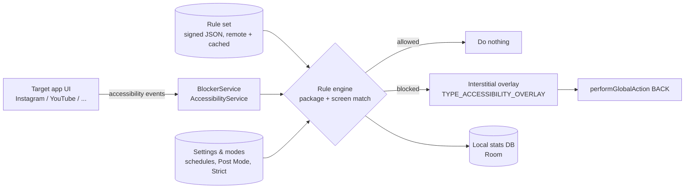

# PRD: Android Short-Form Video Blocker

**Working name:** TBD · **Platform:** Android first (iOS later) · **Reference product:** SocialLite · **As of:** 2026-11-18

We will build an Android app that lets people keep using Instagram, YouTube, TikTok, Facebook and Snapchat for messages, stories, search, profiles and posting. It puts a hard limit on the short-video feeds (Reels, Shorts, For You, Spotlight): by default **20 minutes a day** and **15 videos per session**, then those feeds are blocked. Stories and videos friends send in DMs are always allowed.

---

## 1. Problem

- Short-video feeds are built so one more clip is always one swipe away. Users lose 1 to 3 hours a day without meaning to.
- Blocking the whole app fails for most people, because the same app holds their DMs, friends, tutorials and work content. They uninstall the blocker, or keep finding ways around it.
- App timers (Digital Wellbeing) count total time in the app. They can't tell "replying to a DM" from "40 minutes of Reels".

**What users want:** keep the useful parts of each app and remove the feed.

## 2. Competitive research

### 2.1 SocialLite (the reference product)

| Item | Finding |
|---|---|
| Android listing | "Sociallite - Block Reels&Shorts", package `com.sociallite.android`. First released 2026-03-21, updated 2026-11-11 |
| Android traction | ~588K installs, 18K ratings, 4.5 avg. AppGoblin estimates ~79K MAU and $10K+/month revenue, all from in-app purchases, no ads |
| iOS | 4.7 from 18K ratings, #33 free in Productivity. iOS 17+ |
| Android mechanism | Android **Accessibility Service** that watches social apps and blocks feed surfaces. Optional adult-content blocking uses a **VPN** |
| iOS mechanism | Screen Time "shields" on the native apps send the user into SocialLite's own interface for each platform. Reviewers say the native Instagram app can't be opened while it is installed |
| Blocks | Short-video feeds, algorithmic recommendations and suggested posts, Explore/discovery, live streams, shopping tabs, ads and sponsored posts |
| Keeps | DMs, profiles the user visits on purpose, content friends send, posting and sharing |
| Signature rule | A shared video can be watched, but the user can't scroll to the next one |
| Platforms (iOS version notes) | Instagram, YouTube, Facebook, Snapchat, X, Reddit. TikTok is not named in what we could read |
| Modes and features (iOS notes) | Post Mode (unlocks for 10 min to post), Sleep Mode, focus mode, block whole app categories, custom shield screens, multiple accounts, "AI post filtering", repost filtering, YouTube background audio + PiP, save DM photos |
| Pricing (iOS IAP list) | Pro Monthly $6.99 / $9.99 / $17.99; Pro Yearly $19.99 / $29.99 / $47.90; Pro $3.99; Family Monthly $12.99. The listing doesn't say which price goes with which tier or region |
| Privacy claim | "Doesn't track your browsing, collect your data or sell anything." The APK still includes Facebook, Firebase, AppStack (attribution) and RevenueCat SDKs |
| Complaints (iOS reviews) | DM notifications missing while blocking is on; can't open native Instagram to post |

**Takeaway:** SocialLite proves people want this and will pay for it: 588K Android installs in 8 months. Its weak spots are missing notifications, breakage in the native apps, and a privacy claim that doesn't fully match the SDKs it ships. We can compete on reliability, honest privacy and doing the best job on Android specifically.

### 2.2 Other Android apps

| App | Installs | Rating | Model | Notable features | Mechanism |
|---|---|---|---|---|---|
| [SocialLite](https://appgoblin.info/apps/com.sociallite.android) | 588K | 4.52 (18K) | Free + IAP | Watch a shared video but no next one; blocks Explore, ads, live, shopping | Accessibility, plus VPN for adult content |
| [StopScroll](https://appgoblin.info/apps/com.noscroll.antiscroll) | 280K | 4.67 (9K) | Free + IAP + ads | Blocks Shorts, Reels and TikTok; usage stats; limits. Listing last updated Jan 2026 | Accessibility |
| [ScrollGuard](https://appgoblin.info/apps/com.luderapp.scrollguard) | 209K | 4.74 (3.8K) | Free + IAP | Anti-scroll popup (pause or quit); password Strict Mode shared with an accountability partner; custom break messages | Accessibility, plus Device Admin to prevent uninstall |
| [AppBlock](https://appblock.app/block-reels-shorts-stories-and-spotlight-on-android-with-appblock/) | Large (established) | n/a | Freemium | Section blocking for IG Reels and Stories, YT Shorts, Snap Stories and Spotlight, WhatsApp Status and Channels; schedules by time, usage, location or Wi-Fi; Strict Mode (PIN, charger, cooldown, approval) | Accessibility + overlay |
| [one sec](https://tutorials.one-sec.app/en/articles/4071170) | Large | n/a | Freemium | "Remove In-App Distractions" for Reels and Shorts on Android only (not possible on iOS) | Not stated |
| [Focsy](https://appgoblin.info/apps/com.focsy) | 384 | n/a | Free | Reels/Shorts, schedules, Strict Mode, Friend Approval | Accessibility |
| [Shorts Blocker (OSS)](https://github.com/atick-faisal/Shorts-Blocker) | n/a | n/a | Open source | Navigates back when short-form content is detected | Accessibility |

**Market facts**
- Every serious Android player uses the **AccessibilityService** API. No other public API can see what is on screen inside another app.
- Features are close to a commodity. The real differences are **how reliable detection is after target-app updates**, **how much friction to put in front of bypassing**, and **trust and privacy**.
- Accountability features (ScrollGuard's partner password, Focsy's Friend Approval, AppBlock's approval mode) are now expected in the paid tier.

## 3. Goals, non-goals and success metrics

### Goals
1. Limit short-video feeds inside the top 5 apps to a daily time budget and a per-session video cap (default 20 min/day, 15 videos/session). Everything else in those apps keeps working.
2. Make setup take under 2 minutes, including the accessibility permission.
3. Fix detection within 48 hours when a target app ships an update, without needing a new Play Store release.
4. Earn trust: no content leaves the device, and the privacy story matches the SDKs we ship.

### Non-goals (v1)
- iOS. It needs a separate design based on Screen Time and a web wrapper.
- A full parental-control or child-monitoring product. That falls under a different Play policy (`isMonitoringTool`).
- Our own Instagram or YouTube client or web wrapper.
- Blocking websites in the browser (P2).

### Success metrics

| Metric | Target (90 days after launch) |
|---|---|
| Onboarding → accessibility enabled | ≥ 60% of installs |
| Service still enabled on day 30 | ≥ 40% of activated users |
| Detection recall (feed opened → blocked) on the test matrix | ≥ 98% |
| Video-count accuracy (counted vs actual swipes) on the test matrix | ± 1 per 15 videos |
| Users who end the day under their Reels time limit | ≥ 80% |
| False blocks (legit screen blocked) on the test matrix | ≤ 1% |
| Time to restore detection after a target-app update | ≤ 48 h (median) |
| Blocked attempts per user per day, week 1 vs week 4 | −30% (habit is fading) |
| Free → paid conversion | ≥ 4% |
| Crash-free sessions | ≥ 99.5% |
| Play rating | ≥ 4.5 |

## 4. Target users

| Persona | Situation | What they need |
|---|---|---|
| **Student (16–24)** | Loses evenings to Reels and Shorts; uses Instagram for friends and YouTube for lectures | Free, works right away, YouTube search and long videos keep working |
| **Knowledge worker (25–40)** | Uses LinkedIn, Instagram and YouTube for work and DMs; doomscrolls at night | Schedules (bedtime), Post Mode, privacy |
| **Self-aware relapser** | Has tried and disabled 3+ blockers | Strict Mode, cooldowns, an accountability partner |
| **Parent (later)** | Wants a teen to keep chatting but skip the feed | Family plan; needs a separate parental-control policy track (P2) |

## 5. Features and requirements

### 5.1 What is limited, per app (v1 scope)

"Limited" means the surface works until the short-video budget in 5.4 runs out, then it's blocked for the rest of the session or day.

| App (package) | Limited by budget (default on) | Optional full blocks | Always allowed (never counted) |
|---|---|---|---|
| Instagram (`com.instagram.android`) | Reels tab, Reels viewer swipes, Reels in feed | Explore grid, suggested posts | DMs, **Stories**, profiles, posting, search for people, a Reel opened from a DM |
| YouTube (`com.google.android.youtube`) | Shorts tab, Shorts shelf on Home, Shorts player swipes | Home feed recommendations, comments | Search, subscriptions, long videos, playlists, a Short opened from a shared link |
| TikTok (`com.zhiliaoapp.musically`, `com.ss.android.ugc.trill`) | For You and Following feeds | Whole app | Inbox / DMs, profile, posting, a video opened from a DM |
| Facebook (`com.facebook.katana`) | Reels and Watch | News Feed | Messenger links, groups, Marketplace, profiles |
| Snapchat (`com.snapchat.android`) | Spotlight | Discover | Chat, camera, Stories, Map |

The rules are stored as a **remotely updatable rule set** (see 6.3), so we can add apps (X, Reddit, LinkedIn video) without shipping a new app version.

### 5.2 Core user flows

1. **Onboarding:** pick apps → plain-language explanation of the accessibility permission → prominent-disclosure consent screen → system Accessibility settings → back in the app with a "Protection on" confirmation → battery-optimisation exemption prompt for OEMs that kill background services.
2. **Watching within the budget:** the user opens Reels → it works normally → a small banner shows at 5 reels left and at 2 minutes left.
3. **Hitting a limit:** the 16th reel in a session, or the 20th minute of the day → a full-screen interstitial shows which limit was hit and when Reels open again ("Session limit: back in 30 min" or "Daily limit: back tomorrow") → **Go back** → the app returns to the previous screen.
4. **Shared video:** the user opens a Reel from a DM or link → it always plays, even when the budget is used up or during sleep time, and doesn't count → swiping to the next one counts against the budget like any Reel, and sends them back to the DM thread only when a limit or sleep time applies. An optional "Never swipe past a shared reel" setting blocks the swipe even with budget left.
5. **Sleep time:** during the user's sleep hours (default 23:00–07:00, off until turned on), limited surfaces are blocked with "It's sleep time, back at 7:00". Shared reels still open. Post Mode can't be started during sleep time.
6. **Stories:** never interrupted or counted.
7. **Post Mode:** the user taps "Post" in our app or the notification → the target app's restrictions lift for 10 minutes → a countdown shows in a persistent notification → blocking comes back on.

### 5.3 Requirements by priority

**P0 (MVP)**
- Detect the limited surfaces in 5.1 for Instagram and YouTube. Add TikTok, Facebook and Snapchat before the public launch.
- Short-video budget (5.4): daily time limit, per-session video cap, warnings, limit-reached interstitial.
- Stories and Reels opened from DMs are always allowed and not counted, even at a limit or during sleep time. Swiping on from them counts against the budget.
- Sleep time: a nightly window when limited surfaces are blocked.
- Instagram main home feed (default "Send me to Following"): scrolling down the algorithmic feed opens the Following feed (people you follow, newest first) through the logo menu. Returning to the main feed jumps to the top so Stories stay reachable. Options: stop at "You're all caught up" (scrolling into suggested posts pushes back up), or no limit.
- Shared reels/Shorts (from a DM, or a link tapped in another app) always play and never count. Swiping past one at a limit or in sleep time scrolls back to it and shows the limit screen.
- Strict mode exit: immediate, except while a loosening change is queued (or was in the last 24 h). Then the user must type "I am a loser", and the queued change applies.
- Per-app and per-surface toggles.
- Block interstitial with Go back. The block counter is stored on the device.
- Post Mode (10 min, configurable 5–30).
- Remote rule-set updates (signed JSON, cached, works offline).
- Onboarding with Play-compliant prominent disclosure, plus an OEM battery-exemption guide.
- A health check that detects when the service has been turned off and shows a notification ("Protection is off").
- Daily stats: blocks, estimated minutes saved, streak.
- No content data leaves the device. Analytics are anonymous event counts only, with opt-in.

**P1 (first 3 months after launch)**
- Favourites-only Stories: skip stories from accounts outside a user-picked list.
- Separate budgets per app, instead of one shared budget.
- Schedules beyond sleep time: work hours, custom, per weekday.
- Friction modes: **Soft** (break allowed after a 10-second pause), **Firm** (5-minute daily allowance), **Strict** (no breaks, and changes need a cooldown or a partner).
- Accountability partner: a code sent to a friend is needed to loosen settings.
- Optional blocks: Explore, suggested posts, Home recommendations.
- Usage insights: minutes in each app, split into "feed" and "useful".
- Home-screen widget and quick-settings tile.
- Localisation: EN, ES, PT, FR, DE, AR, HI.

**P2 (later)**
- More apps through the rule set: X, Reddit, LinkedIn, Pinterest, WhatsApp Status and Channels.
- Website blocking in Chrome (Reels and Shorts on the web).
- Family plan / parental mode (separate Play monitoring-tool track).
- Wear OS or lock-screen nudges.
- iOS version.

### 5.4 Short-video budget

| Rule | Default | Range in settings | Detail |
|---|---|---|---|
| Daily time limit | 20 min | 0–120 min | Time a limited surface is in the foreground with the screen on. Resets at local midnight |
| Videos per session | 15 | 1–50 | Each move to a new video in a limited surface counts as one. The first video counts |
| Session reset | 30 min away | 10–120 min | A new session starts after this long without any limited surface open |
| Shared budget | One budget across all apps | Per-app (P1) | Stops people moving from Reels to Shorts when one runs out |
| Warnings | 5 videos left, 2 min left | On/off | Small banner, not a block |
| Not counted | Stories, a video opened from a DM or shared link | Fixed | Always opens, even at a limit or in sleep time. Swiping on counts, and is blocked at a limit or in sleep time; optional: always block it |
| Sleep time | Off, 23:00–07:00 when on | Any window, may cross midnight | Limited surfaces blocked for the whole window |
| Changing limits | Takes effect right away | Strict mode: 24 h cooldown or partner code to raise | Lowering a limit or lengthening sleep time always takes effect right away. Turning Strict mode off is immediate in the test build |

Whichever limit is reached first wins. Time keeps counting while a video is paused, so the user can't game the video count by watching one video for an hour.

## 6. Technical approach (Android)

### 6.1 Architecture

### 6.2 Detection
- **Service config:** an `AccessibilityService` limited to the target packages through `packageNames`. It listens for `TYPE_WINDOW_STATE_CHANGED`, `TYPE_WINDOW_CONTENT_CHANGED` and `TYPE_VIEW_SCROLLED`, with `canRetrieveWindowContent=true`.
- **Signals, used together:**
  1. Activity or class name from window-state events (e.g. a clips or Shorts player activity).
  2. View resource IDs in the node tree (e.g. the Reels viewer pager, the Shorts player container).
  3. Content descriptions and text on the selected bottom-nav tab ("Reels", "Shorts").
  4. Scroll events on a vertical pager inside a known video surface, which mark "next video".
- **Shared-video allowance:** if the previous screen was a DM thread or a shared link, the first video is free. The first vertical-pager scroll after it starts counting against the budget.
- **Budget tracking:**
  - Counting videos: each completed vertical-pager scroll (`TYPE_VIEW_SCROLLED` on the video pager) adds one. A change in the on-screen video author or ID confirms it, so a half swipe that bounces back doesn't count.
  - Counting time: a timer runs while a limited surface is in the foreground. It pauses on screen-off (`ACTION_SCREEN_OFF`) and when the user leaves the surface.
  - Storage: counters live in the local database and survive the service restarting. Daily totals reset at local midnight.
- **Performance:** debounce content-changed events (~150 ms), walk only the subtrees we need, and recycle nodes. Budget: < 2% extra battery per day and < 5 ms average handling per event.

### 6.3 Remote rule set (the key differentiator)
- Each rule says: package, minimum and maximum app version, a match (IDs, descriptions, class names, a structural path), an action (back, overlay, cover a tab) and a priority.
- Rules are signed and downloaded at most every 6 hours. The last good set is cached. Rules carry a version tag so we can roll back.
- We keep an internal **regression farm**: real devices or emulators running the latest beta and stable builds of each target app, with scripted flows. It runs daily and alerts us when a rule stops matching.
- A **"Report broken"** button in the app sends app version, rule ID and device model, with no screen content.

### 6.4 Blocking actions
- Preferred: show an overlay with `TYPE_ACCESSIBILITY_OVERLAY` (no "Display over other apps" permission needed), then `performGlobalAction(GLOBAL_ACTION_BACK)`.
- For tabs: draw a non-interactive cover over the Reels or Shorts tab button so the user can't tap it at all.
- Fallback when BACK doesn't leave the surface (e.g. Shorts opened from Home): send them to the app's Home or Search tab by clicking a node, or as a last resort `GLOBAL_ACTION_HOME`.

### 6.5 Reliability
- OEM background killers (Xiaomi, Oppo, Vivo, Samsung, Huawei): onboarding for each OEM, a battery-optimisation exemption request, and a watchdog that alerts when the service dies.
- A persistent low-priority notification while protection is on (optional, recommended for OEMs that kill services).
- Minimum SDK 26 (Android 8.0). Target the latest SDK Play requires.

### 6.6 Stack
Kotlin, Jetpack Compose, Room, WorkManager (rule sync), DataStore, RevenueCat or Play Billing, Firebase Crashlytics. Analytics must be opt-in and content-free.

## 7. Monetization

SocialLite's IAP list runs from $3.99 to $17.99/month and $19.99 to $47.90/year, plus a $12.99/month family plan. Competitors with fewer features sell for less.

| Tier | Price (proposal) | Includes |
|---|---|---|
| **Free** | $0 | Instagram Reels + YouTube Shorts with the default budget (20 min/day, 15 per session), Stories and DM reels allowed, basic stats |
| **Pro** | $3.99/month or $24.99/year, 7-day trial | All apps and surfaces, custom budget limits, schedules, Post Mode customisation, friction modes, accountability partner, insights |
| **Lifetime** | $49.99 one-time | Pro forever (tests demand among people who dislike subscriptions) |
| **Family** (P2) | $6.99/month | Up to 5 devices |

- No ads, ever. That's part of the trust pitch, and StopScroll gets 68% of its revenue from ads, so it sets us apart.
- Paywall moments: picking a third app, turning on Strict Mode, opening insights after day 3.

## 8. Privacy, compliance and Play review risks

### 8.1 Google Play AccessibilityService policy (what we must do)
Blockers are **not** accessibility tools in Play's definition ("monitoring apps" are listed as ineligible). So we must:
- Show an **in-app prominent disclosure** before asking for the permission. It must appear in the normal flow, stand alone (not bundled with other consents), explain what data the service sees and how it is used, and require an affirmative tap.
- Fill in the **Play Console accessibility declaration**, including a **video** that shows: opening the app → the disclosure → the consent flow → granting the permission → the decline flow and the disclosure appearing again → a core feature working.
- Describe the API use in the **store listing**.
- **Re-submit the declaration** whenever our use of the API changes.
- Allow **several weeks** for review in the launch timeline.

### 8.2 Prohibited uses (design constraints)
- We **must not prevent uninstall or disabling** of our app or other apps. The policy exception covers parental-control apps authorised by a parent, not self-imposed blockers. **Strict Mode will use friction (cooldowns, partner codes), not uninstall blocking and not Device Admin.** ScrollGuard uses Device Admin for this; we see that as a policy risk and won't copy it.
- No autonomous, AI-driven actions through accessibility. Fixed rules ("if surface X, go back") are allowed.
- No deceptive UI changes. Overlays must be clearly ours.
- Don't work around Android security or privacy controls.

### 8.3 Data handling
- Screen content is processed **in memory on the device only**. We never store or send node text.
- Privacy policy in the app and in Play Console; a Data safety form that matches the SDKs we actually ship.
- Opt-in, content-free analytics. No ad-network SDK, which avoids SocialLite's "no tracking" vs Facebook SDK mismatch.
- If we add accounts (partner feature), we must support account deletion in the app and on the web.

### 8.4 Risk register

| Risk | Likelihood | Impact | Mitigation |
|---|---|---|---|
| Target app UI update breaks detection | High (weekly) | High | Remote rules, regression farm, 48 h SLA |
| Play rejects or suspends the accessibility use | Medium | Critical | Strict policy compliance, clean declaration video, no uninstall blocking, conservative scope |
| OEM kills the service | High | Medium | OEM onboarding, watchdog notification |
| Users turn it off in a weak moment | High | Medium | Friction modes, partner codes, a "protection off" nudge |
| Meta or Google change apps to resist accessibility inspection | Low–Medium | High | Several signals together; fall back to time limits for the whole app |
| Instagram notifications or DMs break (SocialLite's complaint) | Medium | High | Never block the notification path or DM screens; include them in regression tests |
| Battery drain complaints | Medium | Medium | Package filter, debounce, performance budget in CI |

## 9. Release plan

| Phase | Weeks | Scope | Exit criteria |
|---|---|---|---|
| 0. Spike | 1–2 | Prototype detection for IG Reels + YT Shorts on 3 devices | Recall ≥ 95% on test flows |
| 1. MVP build | 3–8 | P0 for Instagram + YouTube, remote rules, onboarding, disclosure | Internal dogfood, crash-free ≥ 99% |
| 2. Play declaration | 7–10 (in parallel) | Declaration form + video, Data safety, privacy policy | Play approval |
| 3. Closed beta | 9–12 | Add TikTok, Facebook, Snapchat; regression farm; ~500 testers | D7 service-on ≥ 50%, false blocks ≤ 1% |
| 4. Public launch | 13 | Paywall, localisation (EN first) | Store rating ≥ 4.5 from first 200 ratings |
| 5. P1 | 14–26 | Schedules, friction modes, partner, insights, widget | Paid conversion ≥ 4% |

## 10. Open questions
- Product name and brand. Must avoid confusion with "SocialLite" and with the target apps' trademarks in store listings.
- Do we offer a VPN-based adult-content filter like SocialLite? It adds a second sensitive permission and more review.
- Partner feature: does it need an account, or will an offline code shared out of band do?
- Free tier generosity: block both IG and YT for free, or only one?
- Should "estimated minutes saved" be shown at all, given that estimates can mislead?
- Is iOS a parity product or a different one, given that iOS can't inspect other apps?

## Sources
- SocialLite on the App Store: https://apps.apple.com/us/app/socialliteapp/id6757661674
- SocialLite on Google Play (search listing): https://play.google.com/store/search?q=SocialLite%20block%20reels&c=apps
- SocialLite Android stats (AppGoblin): https://appgoblin.info/apps/com.sociallite.android
- ScrollGuard (AppGoblin): https://appgoblin.info/apps/com.luderapp.scrollguard
- StopScroll (AppGoblin): https://appgoblin.info/apps/com.noscroll.antiscroll
- Focsy (AppGoblin): https://appgoblin.info/apps/com.focsy
- AppBlock, block Reels/Shorts/Stories/Spotlight: https://appblock.app/block-reels-shorts-stories-and-spotlight-on-android-with-appblock/
- AppBlock Android help: https://appblock.app/help/android/
- one sec, Remove In-App Distractions: https://tutorials.one-sec.app/en/articles/4071170
- Shorts Blocker (open source): https://github.com/atick-faisal/Shorts-Blocker
- Google Play, Use of the AccessibilityService API: https://support.google.com/googleplay/android-developer/answer/10964491
- Google Play, Permissions and APIs that access sensitive information: https://support.google.com/googleplay/android-developer/answer/16585319
- Google Play, Declare permissions: https://support.google.com/googleplay/android-developer/answer/9214102
- Google Play, User Data policy: https://support.google.com/googleplay/android-developer/answer/10144311
- Google Play, isMonitoringTool flag: https://support.google.com/googleplay/android-developer/answer/12955211
- Android AccessibilityService reference: https://developer.android.com/reference/android/accessibilityservice/AccessibilityService
- Android restricted settings: https://support.google.com/android/answer/12623953

*Gaps: the SocialLite website (trysociallite.com) failed to load because of a certificate error. Full Google Play detail pages for the apps didn't render, so SocialLite's Android feature list comes from the AppGoblin mirror and the iOS listing. Install and revenue numbers are third-party estimates.*
